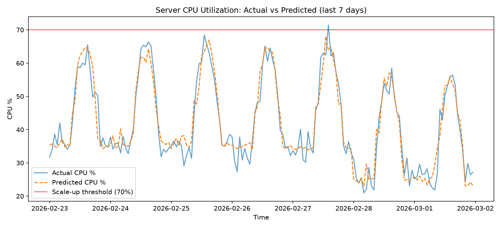

# Server Resource Utilization Forecaster

Predicts hourly server CPU usage for the next 24 hours, so servers can be scaled up **before** a traffic peak instead of after a crash.



## Problem
When traffic suddenly increases and a server doesn't have enough capacity, it slows down or crashes. If we can predict the busy times in advance, extra capacity can be added in time.

## How It Works
1. Generates 60 days of synthetic hourly CPU usage data (busy in the daytime, quieter on weekends)
2. Creates features: hour of day, day of week, usage at the same hour 1, 2 and 7 days ago, and yesterday's average
3. Trains a Gradient Boosting Regressor (an ensemble of decision trees)
4. Tests the model on the last 7 days of data, which it never saw during training
5. Forecasts the next 24 hours and raises an alert if predicted CPU crosses the threshold (70% by default)

## Results
- Mean Absolute Error (MAE): about 2.8 CPU%
- RMSE: about 3.7 CPU%
- The model predicts the daily peak time correctly (around 2 PM in the sample data)

## Web App
An interactive Streamlit app lets you:
- Change the data size, alert threshold and number of trees
- See live metrics and a scale-up alert
- View actual vs predicted graphs and the 24-hour forecast
- Download the data as CSV

## Tech Stack
Python, Pandas, NumPy, Scikit-learn, Matplotlib, Streamlit

## How to Run

```
git clone https://github.com/sprihasahu/server-resource-forecaster.git
cd server-resource-forecaster/codes
pip install -r requirements.txt
```

Run the script:

```
python server.py
```

Run the web app:

```
streamlit run app.py
```

## Project Structure

```
codes/
  server.py          # data generation, model training, evaluation, graph
  app.py             # Streamlit web app
  forecast.png       # output graph
  requirements.txt   # libraries needed
```

## Note
The data is synthetic and generated by the code to build and validate the pipeline. The same approach works on real server metrics (for example, a CSV exported from AWS CloudWatch).

## Author
Spriha Sahu
[GitHub](https://github.com/sprihasahu) | [LinkedIn](https://linkedin.com/in/spriha-sahu-81bb60257)
